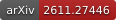
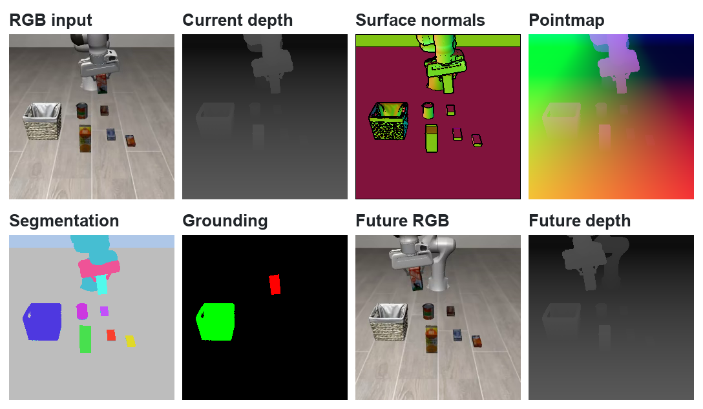

# GenPA: Image Generators as Efficient Robot Policies

Zian Deng, Tianyi Zhang, Zilong Zheng, Ziyu Liu, Tao Zhang, Yao Lyu, Shengbo Eben Li

[](./README.md)
[](./README_zh-CN.md)

[](https://deng-zian.github.io/GenPA-website/assets/genpa-paper.pdf)
[](https://deng-zian.github.io/GenPA-website/)
[](https://huggingface.co/Deduktive/GenPA)
[](https://huggingface.co/datasets/Deduktive/GenPA-LIBERO)
[](#citation)

GenPA adapts a pretrained FLUX.2 [klein] base 4B image generator to predict **16 robot actions in one forward pass** from RGB images, an instruction and robot state. A shared backbone for action regression and visual supervision lets us compare depth, segmentation and future prediction while holding the policy architecture fixed. [Policy architecture](docs/ARCHITECTURE.md)

<picture>
  <source media="(max-width: 600px)" srcset="docs/assets/visual-supervision-mobile.png">
  
</picture>

*One LIBERO demonstration, seven visual targets. The RGB input and current-scene targets share a frame. Future RGB and depth are taken 16 retained action steps later. These targets supervise training.* [Explore both camera views](https://deng-zian.github.io/GenPA-website/#visual-targets)

## Results

| Benchmark | Task success with the released depth policy |
| --- | --- |
| LIBERO | **99.10%** on the checkpoint-selection states. **98.33 ± 0.29%** across three independent sets of initial states with the same checkpoint. |
| LIBERO-Plus | **83.79%** with Clean instructions and **83.01%** with Official instructions. |
| RoboTwin 2.0 | **92.08%** on Clean and **90.82%** on Randomized, averaging **91.45%**. |

Predicting one 16-action chunk on LIBERO takes **27.86 ms** on a single H100 with a cached instruction (batch size 1, uncompiled). [Evaluation protocols and full results](docs/RESULTS.md) · [Latency breakdown](https://deng-zian.github.io/GenPA-website/#efficiency)

## Run a checkpoint

Start with the LIBERO depth policy on Linux with an NVIDIA GPU. The repository includes a two-camera observation, robot state and cached instruction. You can run this first prediction before installing a simulator or downloading demonstrations.

<details>
<summary><strong>First-time setup</strong> · Install GenPA and download the two FLUX files</summary>

```bash
git clone https://github.com/deng-zian/GenPA.git
cd GenPA
python3.11 -m venv .venv
source .venv/bin/activate
python -m pip install torch==2.7.1 torchvision==0.22.1 --index-url https://download.pytorch.org/whl/cu118
python -m pip install -e '.[inference]'
```

Accept the autoencoder terms on the [FLUX.2-dev model page](https://huggingface.co/black-forest-labs/FLUX.2-dev) and sign in to Hugging Face. Run the remaining commands in the same shell.

```bash
hf auth login
hf download black-forest-labs/FLUX.2-klein-base-4B flux-2-klein-base-4b.safetensors --local-dir artifacts/flux
hf download black-forest-labs/FLUX.2-dev ae.safetensors --local-dir artifacts/flux
export GENPA_FLUX2_WEIGHTS="$PWD/artifacts/flux/flux-2-klein-base-4b.safetensors"
export GENPA_FLUX2_AE="$PWD/artifacts/flux/ae.safetensors"
```

If you have the two upstream files locally, set the variables to their existing paths. [Environment details](docs/SETUP.md#run-a-checkpoint)

</details>

```bash
hf download Deduktive/GenPA genpa_libero_depth.pt --local-dir artifacts/models
python tools/smoke_policy.py --benchmark libero \
  --checkpoint artifacts/models/genpa_libero_depth.pt
```

The example returns a normalized action chunk of shape `[16, 7]` and reports `all_finite: true`.

## Checkpoints

| File | What to use it for |
| --- | --- |
| `genpa_libero_depth.pt` | Main LIBERO and LIBERO-Plus policy. Trained with current-scene depth supervision. |
| `genpa_libero_action_only.pt` | LIBERO baseline trained on the same demonstrations using action supervision alone. |
| `genpa_robotwin_depth.pt` | Bimanual RoboTwin 2.0 policy for both Clean and Randomized conditions. Outputs a `[16, 14]` action chunk. |

Depth is a training target. All three checkpoints run from RGB, language and robot state. [Model downloads](https://huggingface.co/Deduktive/GenPA) · [Checkpoint steps and configurations](docs/CHECKPOINTS.md)

## Datasets

**To train on LIBERO**, download `paper/` (45.85 GiB). It contains the 1,808 successfully replayed demonstrations used by both LIBERO recipes, with aligned RGB, actions, robot state and metric depth.

```bash
hf download Deduktive/GenPA-LIBERO --repo-type dataset \
  --include 'paper/*' --local-dir artifacts/GenPA-LIBERO
```

**To explore visual supervision**, open the [1.70 MiB sample](https://huggingface.co/datasets/Deduktive/GenPA-LIBERO/resolve/main/samples/libero_spatial.npz?download=true) on CPU. You can inspect depth, surface normals, pointmaps, segmentation, grounding, future RGB and future depth for both cameras. To construct these seven targets yourself, pick one of the 40 task archives (2,000 demonstrations in total) and follow the [one-task reader example](docs/DATA.md#visual-supervision).

**For RoboTwin 2.0**, use the [Flex-π RGB-D demonstrations](https://huggingface.co/datasets/flex-pi/robotwin_3d) and the [pinned revision and preparation commands](docs/DATA.md#robotwin-20).

## Training

After [installing the training dependencies](docs/SETUP.md#training), follow the [LIBERO data and instruction-cache setup](docs/TRAINING.md#libero). Then launch the depth recipe from the repository root.

```bash
GENPA_OUTPUT_DIR="$PWD/outputs/libero-depth" bash scripts/libero/train.sh depth
```

For the matched LIBERO baseline, pass `action_only` and choose a separate output directory. The [RoboTwin recipe](docs/TRAINING.md#robotwin-20) uses `bash scripts/robotwin/train.sh` with its own data and cache. The paper’s training configurations use eight GPUs. [LIBERO depth config](configs/libero/depth.yaml) · [Action-only config](configs/libero/action_only.yaml) · [RoboTwin config](configs/robotwin/depth.yaml)

## Evaluation

After [configuring the standard LIBERO simulator, checkpoint and instruction cache](docs/EVALUATION.md#standard-libero), try one episode on GPU 0.

```bash
mkdir -p artifacts
printf 'libero_spatial,0\n' > artifacts/one-task.txt
GENPA_EVAL_OUTPUT="$PWD/outputs/libero-one-episode" bash scripts/libero/evaluate.sh standard \
  --gpus 0 --task-file artifacts/one-task.txt --trials 1
```

For the full benchmark, omit `--task-file` and `--trials` and choose a fresh output directory. Each worker runs its simulator and policy on the same GPU. Start with one GPU and one worker, or set `--gpus` and `--workers-per-gpu` to suit your machine.

[LIBERO-Plus evaluation](docs/EVALUATION.md#libero-plus) · [RoboTwin evaluation](docs/EVALUATION.md#robotwin-20) · [Tested GPU configurations](docs/EVALUATION.md#measured-h100-configurations)

## Citation

```bibtex
@misc{deng2026genpa,
  title  = {{GenPA}: Image Generators as Efficient Robot Policies},
  author = {Deng, Zian and Zhang, Tianyi and Zheng, Zilong and Liu, Ziyu and Zhang, Tao and Lyu, Yao and Li, Shengbo Eben},
  year   = {2026},
  url    = {https://deng-zian.github.io/GenPA-website/}
}
```

[Code license](LICENSE) · [Third-party assets](THIRD_PARTY_NOTICES.md)
