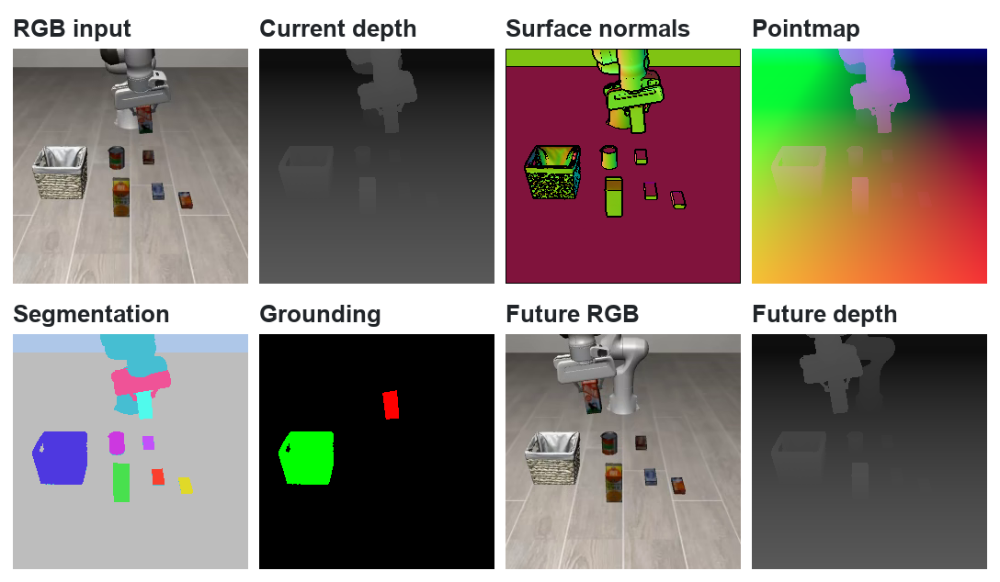

# GenPA: Image Generators as Efficient Robot Policies

Zian Deng, Tianyi Zhang, Zilong Zheng, Ziyu Liu, Tao Zhang, Yao Lyu, Shengbo Eben Li

[](./README.md)
[](./README_zh-CN.md)

[](https://deng-zian.github.io/GenPA-website/assets/genpa-paper.pdf)
[](https://deng-zian.github.io/GenPA-website/)
[](https://huggingface.co/Deduktive/GenPA)
[](https://huggingface.co/datasets/Deduktive/GenPA-LIBERO)
[](#引用)

GenPA 将预训练图像生成模型 FLUX.2 [klein] base 4B 用于机器人控制。输入 RGB 图像、语言指令和机器人状态，策略**一次前向计算即可预测连续 16 步动作**。动作回归和视觉监督共用同一个主干，因此可以在固定策略架构下，比较深度、分割和未来帧预测等训练目标。[策略架构](docs/ARCHITECTURE.md)

<picture>
  <source media="(max-width: 600px)" srcset="docs/assets/visual-supervision-mobile.png">
  
</picture>

*同一条 LIBERO 演示中的七种视觉监督。当前场景的目标与输入 RGB 取自同一帧，未来 RGB 和深度取自向后数 16 个保留动作步的帧。* [查看两个相机视角](https://deng-zian.github.io/GenPA-website/#visual-targets)

## 实验结果

| 基准 | 已发布深度监督策略的任务成功率 |
| --- | --- |
| LIBERO | 在用于选择检查点的初始状态上为 **99.10%**。 |
| LIBERO-Plus | 使用 Clean 指令为 **83.79%**，使用 Official 指令为 **83.01%**。 |
| RoboTwin 2.0 | Clean 为 **92.08%**，Randomized 为 **90.82%**，平均 **91.45%**。 |

在单张 H100 上，LIBERO 策略预测一段 16 步动作耗时 **27.86 ms**（已缓存指令，batch size 为 1，未编译）。[评测协议和完整结果](docs/RESULTS.md) · [延迟分解](https://deng-zian.github.io/GenPA-website/#efficiency)

## 第一次运行策略

在配备 NVIDIA GPU 的 Linux 机器上，可以先运行 LIBERO 深度监督策略。仓库自带一次推理所需的双相机观测、机器人状态和指令缓存，安装模拟器、下载演示数据可以留到训练或闭环评测时再做。

<details>
<summary><strong>首次安装</strong> · 配置环境并下载两个 FLUX 文件</summary>

```bash
git clone https://github.com/deng-zian/GenPA.git
cd GenPA
python3.11 -m venv .venv
source .venv/bin/activate
python -m pip install torch==2.7.1 torchvision==0.22.1 --index-url https://download.pytorch.org/whl/cu118
python -m pip install -e '.[inference]'
```

在 [FLUX.2-dev 模型页](https://huggingface.co/black-forest-labs/FLUX.2-dev) 接受自编码器的使用条款，登录 Hugging Face，然后在同一个终端中运行以下命令。

```bash
hf auth login
hf download black-forest-labs/FLUX.2-klein-base-4B flux-2-klein-base-4b.safetensors --local-dir artifacts/flux
hf download black-forest-labs/FLUX.2-dev ae.safetensors --local-dir artifacts/flux
export GENPA_FLUX2_WEIGHTS="$PWD/artifacts/flux/flux-2-klein-base-4b.safetensors"
export GENPA_FLUX2_AE="$PWD/artifacts/flux/ae.safetensors"
```

如果本地已有这两个文件，将上述两个环境变量指向对应路径即可。[环境配置说明](docs/SETUP.md#run-a-checkpoint)

</details>

```bash
hf download Deduktive/GenPA genpa_libero_depth.pt --local-dir artifacts/models
python tools/smoke_policy.py --benchmark libero \
  --checkpoint artifacts/models/genpa_libero_depth.pt
```

运行成功后会返回形状为 `[16, 7]` 的归一化动作序列，并输出 `all_finite: true`。

## 选择权重

| 文件 | 用途 |
| --- | --- |
| `genpa_libero_depth.pt` | LIBERO 和 LIBERO-Plus 主结果使用的策略，训练时使用当前场景的深度监督。 |
| `genpa_libero_action_only.pt` | LIBERO 对照策略，使用相同的演示数据，仅使用动作监督。 |
| `genpa_robotwin_depth.pt` | RoboTwin 2.0 双臂策略，适用于 Clean 和 Randomized 两种条件，输出形状为 `[16, 14]`。 |

深度用于训练监督。三个策略推理时都使用 RGB、语言指令和机器人状态。[下载模型权重](https://huggingface.co/Deduktive/GenPA) · [训练步数与配置](docs/CHECKPOINTS.md)

## 数据集与视觉监督

**复现 LIBERO 训练**只需下载 `paper/`（45.85 GiB）。深度监督和纯动作两种训练配置共用其中 1,808 条成功回放的演示，每条演示都包含对齐的 RGB、动作、机器人状态以及以米为单位的深度。

```bash
hf download Deduktive/GenPA-LIBERO --repo-type dataset \
  --include 'paper/*' --local-dir artifacts/GenPA-LIBERO
```

**查看七种视觉目标**可以从 [1.70 MiB 的样本](https://huggingface.co/datasets/Deduktive/GenPA-LIBERO/resolve/main/samples/libero_spatial.npz?download=true) 入手，在 CPU 上即可查看两个相机视角的深度、表面法线、三维坐标图、语义分割、任务指代（grounding）、未来 RGB 和未来深度。要自己构造这些目标，可以从 40 个任务归档（共 2,000 条演示）中任选一个，运行[单任务读取示例](docs/DATA.md#visual-supervision)。

**训练 RoboTwin 2.0** 使用 [Flex-π RGB-D 演示数据](https://huggingface.co/datasets/flex-pi/robotwin_3d)。[数据版本与准备命令](docs/DATA.md#robotwin-20)

## 训练

先[安装训练依赖](docs/SETUP.md#training)，然后[配置 LIBERO 数据目录与语言指令缓存](docs/TRAINING.md#libero)。在仓库根目录运行以下命令启动深度监督训练。

```bash
GENPA_OUTPUT_DIR="$PWD/outputs/libero-depth" bash scripts/libero/train.sh depth
```

训练纯动作对照策略时，将参数改为 `action_only`，并指定另一个输出目录。[RoboTwin 训练](docs/TRAINING.md#robotwin-20)使用独立的数据和指令缓存，入口为 `bash scripts/robotwin/train.sh`。论文中的训练配置使用 8 张 GPU。[LIBERO 深度监督配置](configs/libero/depth.yaml) · [纯动作配置](configs/libero/action_only.yaml) · [RoboTwin 配置](configs/robotwin/depth.yaml)

## 评测

按[标准 LIBERO 评测说明](docs/EVALUATION.md#standard-libero)配置模拟器、权重和指令缓存后，可以先在 GPU 0 上运行一个回合。

```bash
mkdir -p artifacts
printf 'libero_spatial,0\n' > artifacts/one-task.txt
GENPA_EVAL_OUTPUT="$PWD/outputs/libero-one-episode" bash scripts/libero/evaluate.sh standard \
  --gpus 0 --task-file artifacts/one-task.txt --trials 1
```

运行完整基准时，去掉 `--task-file` 和 `--trials`，并使用新的输出目录。每个评测进程在同一张 GPU 上运行模拟器和策略。可以先用一张 GPU、一个进程，再通过 `--gpus` 和 `--workers-per-gpu` 调整并行度。

[LIBERO-Plus 评测](docs/EVALUATION.md#libero-plus) · [RoboTwin 评测](docs/EVALUATION.md#robotwin-20) · [已测试的 GPU 配置](docs/EVALUATION.md#measured-h100-configurations)

## 引用

```bibtex
@misc{deng2026genpa,
  title  = {{GenPA}: Image Generators as Efficient Robot Policies},
  author = {Deng, Zian and Zhang, Tianyi and Zheng, Zilong and Liu, Ziyu and Zhang, Tao and Lyu, Yao and Li, Shengbo Eben},
  year   = {2026},
  url    = {https://deng-zian.github.io/GenPA-website/}
}
```

[代码许可证](LICENSE) · [第三方资源说明](THIRD_PARTY_NOTICES.md)
