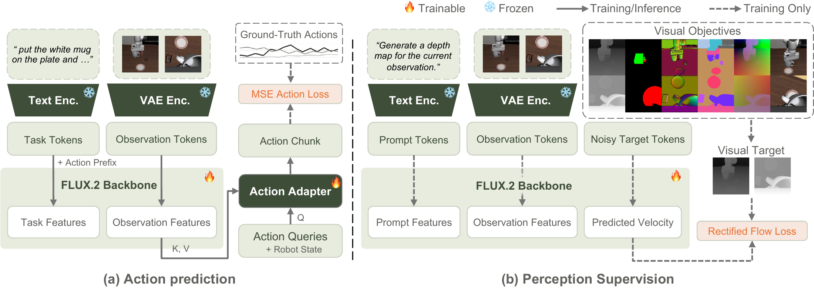

# Policy architecture

The LIBERO source provides the common policy design; RoboTwin specializes its view packing, action normalization and loss reduction.

| Mechanism | Source |
|---|---|
| Action-only reference-token forward; no target-image tokens | `src/genpa/models/backbones/reference_policy.py` |
| Learned action queries, Transformer decoder, prefix packing and attention mask | `src/genpa/models/backbones/action_model.py` |
| Current-depth flow-matching objective and joint losses | `src/genpa/models/backbones/genpa.py` |
| Optimizer and updates | `src/genpa/trainer.py` |
| Metric-depth target representation | `src/genpa/datasets/lerobot/depth_targets.py` |
| RGB/depth augmentation | `src/genpa/datasets/lerobot/transforms/image.py` |
| RoboTwin absolute action and compact camera layout | `src/genpa/robotwin/policy/` |
| RoboTwin joint action/perception optimization | `src/genpa/robotwin/depth/trainer.py` |
| Clean-Instruction construction | `scripts/libero/build_clean_instruction_manifest.py` |
| Online RoboTwin action execution and instruction reuse | `experiments/robotwin/policy/policy.py` |

The action pass reads features from the final reference-token states through the regression adapter. Perception training instead adds noisy depth-target tokens and uses the native FLUX output projection. Both objectives update the shared DiT. Qwen and VAE parameters remain frozen. Deployment does not generate depth or iteratively denoise actions.

## One package, explicit variants

`src/genpa/models/backbones/` contains the LIBERO policy and shared FLUX wrappers.
`src/genpa/models/robotwin/` preserves the RoboTwin inference implementation,
including packed-prompt reuse and attention compatibility with its PyTorch 2.4
simulator runtime. Both import the same FLUX wrapper, scheduler and utility modules.
The small reference-policy inheritance chain remains explicit so that selecting a
benchmark never silently selects a different `genpa` package via `PYTHONPATH`.

`src/genpa/robotwin/` holds the benchmark's camera packing, absolute-action contract,
datasets and training specialization. `depth/` supplies the RGB-D base;
`multiview/` supplies the compact view layout; `policy/` binds the published recipe.
The base trainer in this directory retains its original checkpoint and evaluation
rules; the LIBERO trainer remains `src/genpa/trainer.py`.

`experiments/` owns simulator integration and process scheduling. It is separate
from the installable model package. `third_party/robotwin/` is the byte-preserved
upstream evaluator with its source checksum. Model checkpoint dictionaries retain
their tensor keys; stored YAML factory locations must use the current configs.
